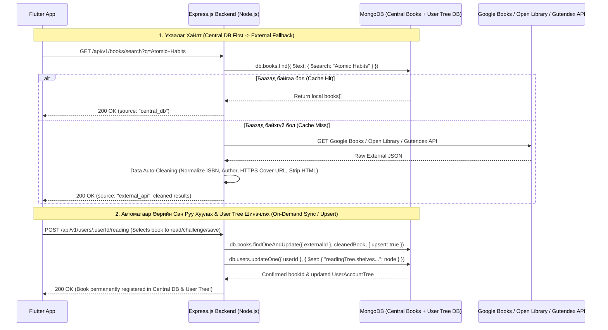

# 🚨 BRUTAL PRODUCT, UI/UX VISUAL HIERARCHY & BACKEND ARCHITECTURE CRITIQUE (v4.0)
**App Name:** ReadPack (Mobile Screenshot Teardown + Express.js & MongoDB Tree System Audit)  
**Evaluator:** Senior Product Critic, Principal UX Architect & Distributed Systems Engineer  
**Audit Date:** 2026-11-05  
**Audit Mode:** STRICT FULL-SPECTRUM AUDIT (Zero Artificial Action-Item Limits — 100% Issue Coverage)

---

## 1. Ерөнхий дүн (Brutal Reality Check)

> **Одоогийн түвшин:** **Broken Visual Hierarchy / Client-Only Illusion**  
> **Бодит утасны дэлгэц дээрх үнэлгээ:** **3.5 / 10**

Бодит утасны дэлгэц (Screenshots 1–4) дээр апп-ыг ажиллуулахад өмнөх "81 тест давсан" гэх тайлангийн цаана **UI эвдрэл (116px Overflow), орчуулгын түүхий түлхүүрүүд (`settings.appearance`, `settings.manage`, `quote_share.share`), давхардсан анимаци, Зочин (Guest) болон Нэвтэрсэн хэрэглэгчийн логикийн холион бантан**, мөн **Төвлөрсөн дата баазгүй (No Backend/DB)** архитектур нуугдаж байна.

---

## 2. Бодит Дэлгэцийн Баримттай Шүүмж (Screenshot-by-Screenshot Teardown)

### 📸 Баримт 1: Нүүр хуудасны Visual Hierarchy ба "Хуурамч Хэрэглэгч" (`HomePage` — Screenshot 4)

1. **Зочин (Guest) мөртлөө Нэвтэрсэн хүн шиг харагдах логикийн гажуудал (`header.dart:40`):**
   - Хэрэглэгч огт нэвтрээгүй байхад зүүн дээд буланд `"З"` үсэгтэй аватар, `"Оройн мэнд, Зочин уншигч"`, `"🔥 0 хоног"` (Streak), мөн Мэдэгдлийн хонх харагдаж байна.
   - **Яагаад буруу вэ?** Зочин хүн бол бүртгэлгүй уншигч. Түүнд хувийн аватар, 0 хоногийн гал, хувийн мэдэгдэл харуулах нь хэрэглэгчийг "Би аль хэдийн бүртгэлтэй юм байна" гэж төөрөгдүүлж, бүртгүүлэх (Conversion) сэдлийг 100% устгадаг.
   - **Эксперт шийдэл (Apple Books / Medium):** Зочин үед Header дээр зөвхөн Апп-ын цэвэрхэн лого (`ReadPackLogo`) + баруун буланд цэмцгэр `"Нэвтрэх"` товч байх ёстой. Streak болон Avatar нь зөвхөн нэвтэрсэн хүний урамшуулал байх ёстой.

2. **Давхардсан хоёр Refresh Indicator (`refresh.dart:108-189`):**
   - Дэлгэцийг доош татахад Flutter-ийн стандарт бөөрөнхий `RefreshIndicator` эргэлдэж, яг доор нь давхардаад `"🔄 Тавьж шинэчлэх"` гэсэн хоёр дахь pill гарч ирж байна. Энэ бол маш бүдүүлэг UI давхардал.

3. **Номын карт дээрх Текст давхцал ба Харагдах байдлын шатлал (`features_book.dart:69-83`, `books_card.dart`):**
   - `"Онцлох номнууд"` хэсгийн *Thinking, Fast and Slow* болон *The Art of War* номын ковер зураг нь өөр дээрээ том үсэгтэй. Гэтэл яг тэр үсгэн дээр нь цагаан өнгөөр `The Art of War / Sun Tzu` гээд давхарлаж бичсэнээс болж хоёр текст хоорондоо холилдоод уншигдахын аргагүй заваан харагдаж байна.
   - Мөн ковер бүр дээр хэт тод улбар шар `"🎧 Аудио хүүрнэл"` гэсэн шошго наасан нь номын хавтсыг халхалж, хямдхан сурталчилгааны баннер шиг харагдуулж байна.
   - `Image.asset` нь `https://` сүлжээний зургийг дэмжихгүй байгаагаас гадны API-аас ирсэн номын хавтас алдаа зааж байна.

4. **Түүхий орчуулгын түлхүүр (`home_quote_banner.dart:95`):**
   - Өдрийн эшлэл карт дээр `"Хуваалцах"` гэж гарахын оронд `< quote_share.share` гэсэн кодын түлхүүр үг шууд гарч ирсэн.
   - **Шалтгаан (`translation.dart:44`):** `AppLocalizations.translate(key)` функц нь түлхүүр олдохгүй үед `null` биш `key` буцаадаг тул `l10n?.t('quote_share.share') ?? 'Хуваалцах'` гэсэн Dart-ийн `??` оператор хэзээ ч ажилладаггүй!

---

### 📸 Баримт 2: Профайл ба Зочны Горимын Зөрчил (`ProfilePage` — Screenshot 1)

1. **Зочин хүнд "Профайл засах" ба `guest@readpack.app` харуулах (`profile_header_card.dart:108-119`):**
   - Хэрэглэгч Зочин горимд байхад дээр нь `Зочин уншигч`, `guest@readpack.app` гэсэн хуурамч имэйл харуулаад, баруун талд нь **Харандаа (Edit Profile)** товч үлдээсэн байна!
   - Тэр харандааг дарахад `"Профайл засах -> Бүтэн нэр: Зочин"` гэсэн модал гарч ирж байна. Бүртгэлгүй зочин хүн яагаад өөрийнхөө нэрийг "Зочин"-гоос өөрчилж хадгалах ёстой гэж?!
   - **Эксперт шийдэл:** Зочин үед `guest@readpack.app` болон Edit товч (`ProfileEditDialog`) ОГТ харагдах ёсгүй. Профайл таб руу ороход бүртгүүлэхийг урьсан цэвэрхэн Onboarding/Auth Hero карт (`ProfileGuestCard`) болон Апп-ын ерөнхий тохиргоо (Хэл, Харанхуй горим) л байх ёстой.

2. **Дахин түүхий түлхүүр (`profile_settings_card.dart:94`):**
   - Тохиргоо хэсгийн баруун дээр `settings.manage` гэсэн түүхий текст улаан цайм харагдаж байна.

---

### 📸 Баримт 3: Нэвтрэх Хуудасны 116 Пикселийн Эвдрэл (`AuthPage` — Screenshot 2)

1. **`RIGHT OVERFLOWED BY 116 PIXELS` (`auth.dart:199`):**
   - Дээд навигацийн мөрөнд `<` буцах товч, `ReadPack` лого, `"Уншлагын зорилго тохируулах ->"` товч, `"Алгасах"` товч дөрвийг нэг `Row` дотор чихсэнээс болж дэлгэцийн баруун тийш **116 пикселээр хальж, шар-хар эрээн анхааруулах тууз** гарсан байна.
2. **Урсгалын логик алдаа (Broken User Journey):**
   - Хэрэглэгч Нүүр хуудаснаас Зочноор эхлээд -> Профайл руу ороод -> `"Нэвтрэх / Бүртгүүлэх"` дарж энэ хуудас руу орж ирсэн.
   - Гэтэл энэ хуудасны голд дахиад `"Зочноор үргэлжлүүлэх ->"` болон дээр нь хэт урт `"Уншлагын зорилго тохируулах"` гэсэн илүү товчнууд байгаа нь хэрэглэгчийг буцаад тойрог руу шиддэг.

---

### 📸 Баримт 4: Тохиргооны Хуудасны Орчуулгын Сүйрэл (`SettingsPage` — Screenshot 3)

1. **Бүх гарчиг нь кодын түлхүүрээрээ гарсан (`settings_page.dart:34, 91, 135`):**
   - `settings.appearance`
   - `settings.notifications`
   - `settings.storage`
   Эдгээр нь `assets/locales/mn.json` болон `en.json` дотор огт бичигдээгүй мөртлөө `t()` функц нь `null` буцаадаггүйгээс болж хэрэглэгчид шууд кодын хувьсагчийн нэр харагдаж байна.

---

## 3. Харагдах Байдлын Шатлал (Visual Hierarchy) Шүүмж

Одоогийн UI яагаад "сонирхогчийн" харагдаж байна вэ?
1. **Хэт олон өрсөлдөгч өнгө ба хүрээ (Competing Borders & Badges):**
   - Бүх карт хүрээтэй (`Border.all`), бүх товч сүүдэртэй, ном болгон дээр 2–3 өнгийн badge (`Бизнес`, `🎧 Аудио хүүрнэл`, `⭐ 4.1`, `Унших ->`) наасан. Хэрэглэгчийн нүд хаашаа харахаа мэдэхгүй ядардаг.
2. **Номын ковер ба Мэдээллийг салгах зарчим (Image vs. Metadata Separation) зөрчигдсөн:**
   - Дэлхийн шилдэг аппууд (Apple Books, Kindle, Goodreads) номын хавтасны зурган дээр **ХЭЗЭЭ Ч** давхар текст бичдэггүй! Номын хавтас өөрөө урлагийн бүтээл бөгөөд өөр дээрээ гарчигтай байдаг. Гарчиг, зохиолч, үнэлгээг хавтасны **доор** эсвэл **хажууд** цэвэрхэн зайд бичдэг.

---

## 4. Төвлөрсөн Дата Бааз ба Ухаалаг Express.js + MongoDB (Hierarchical Tree) Архитектур

### Одоогийн мухардал:
Апп нь шууд утаснаасаа `gutendex.com` руу хүсэлт шидээд, ирсэн өгөгдлийг зөвхөн тухайн утасны `SharedPreferences` дотор хадгалж байна. Хэрэглэгчийн бүртгэл, уншиж буй ном, челленж, сэтгэгдэл нь нэгдсэн сервер дээр огт бүртгэгддэггүй.

### Шаардлагатай Эксперт Архитектур (Express.js Backend + MongoDB Tree Document + Smart Read-Through Caching):



#### Эксперт Дата Авто-Цэвэрлэгээ (`/data-autocleaning` зарчим):
Гадны API (Google Books / Open Library / Gutendex)-аас орж ирсэн өгөгдөл маш бохир байдаг тул Express.js сервис MongoDB рүү хадгалахаас өмнө дараах цэвэрлэгээг автоматаар хийнэ:
1. **Deduplication (Давхардлыг арилгах):** `isbn13`, `externalId`, эсвэл `normalizedTitle + normalizedAuthor` хослолоор шалгаж, нэг ном баазад 2 удаа орохоос сэргийлнэ.
2. **Author & Title Canonicalization:** `"Clear, James"` -> `"James Clear"`, илүү хаалт, HTML тагуудыг (`<b>`, `<p>`, `<br>`) цэвэрлэнэ.
3. **Cover Image Upgrade:** `http://` болон жижиг `zoom=1` зургийг автоматаар `https://` URL руу хөрвүүлнэ; зураггүй бол стандарт fallback онооно.

---

## 5. MongoDB User Account Tree Бүтэц ба Central Books Схем (Production Schema Blueprint)

Хэрэглэгчийн бүртгэлийн мэдээллийг MongoDB дээр **Мод бүтэцтэй (Hierarchical Tree Structure — `UserAccountTree`)** документ хэлбэрээр хадгална:

```json
{
  "_id": "ObjectId('...')",
  "userId": "usr_enkush_01",
  "email": "enkush@readpack.app",
  "authNode": {
    "passwordHash": "$2b$10$...",
    "provider": "email",
    "lastLoginAt": "2026-11-05T10:00:00.000Z"
  },
  "profileNode": {
    "displayName": "Enkush",
    "avatarUrl": null,
    "bio": "Passionate reader & lifelong learner",
    "preferencesNode": {
      "language": "mn",
      "theme": "system",
      "dailyGoalMinutes": 30,
      "yearlyBookGoal": 24,
      "favoriteGenres": ["Бизнес", "Хувь хүний хөгжил", "Сэтгэл зүй"],
      "notificationsEnabled": true,
      "recommendationsEnabled": true
    }
  },
  "readingTree": {
    "shelves": [
      {
        "shelfId": "currently_reading",
        "name": "Уншиж буй",
        "childrenBooks": [
          {
            "bookId": "book_atomic_habits",
            "status": "reading",
            "progress": 0.65,
            "currentChapter": 2,
            "currentPage": 140,
            "updatedAt": "2026-11-05T10:00:00.000Z",
            "highlightsNodes": [
              {
                "highlightId": "hl_01",
                "chapterIndex": 1,
                "text": "You do not rise to the level of your goals. You fall to the level of your systems.",
                "color": "yellow",
                "createdAt": "2026-11-05T09:30:00.000Z"
              }
            ],
            "notesNodes": [
              {
                "noteId": "nt_01",
                "content": "Өдөр тутмын системээ сайжруулах.",
                "createdAt": "2026-11-05T09:31:00.000Z"
              }
            ]
          }
        ]
      },
      {
        "shelfId": "saved",
        "name": "Хадгалсан",
        "childrenBooks": []
      },
      {
        "shelfId": "completed",
        "name": "Уншиж дууссан",
        "childrenBooks": []
      }
    ]
  },
  "gamificationTree": {
    "xpNode": {
      "totalXp": 1450,
      "level": 2,
      "title": "Идэвхтэй уншигч (Lv. 2)",
      "weeklyLeague": "Gold League"
    },
    "streakNode": {
      "currentStreak": 7,
      "longestStreak": 14,
      "minutesReadToday": 24,
      "streakFreezeAvailable": true,
      "historyDates": ["2026-11-01", "2026-11-02", "2026-11-03", "2026-11-04", "2026-11-05"]
    },
    "challengeNode": {
      "year": 2026,
      "targetBooks": 24,
      "completedBookIds": ["book_1", "book_2"],
      "achievementsNodes": [
        {
          "id": "streak_7",
          "title": "🔥 7 Day Streak",
          "isUnlocked": true,
          "progress": 1.0
        }
      ]
    }
  }
}
```

---

## 6. Бүрэн Шийдвэрлэх Ажлын Төлөвлөгөө (Complete Unrestricted Action Plan — Бүх Шүүмжийг 100% Шийдвэрлэх)

> **Тэмдэглэл:** Хийх ажлыг зөвхөн 5 зүйлээр хязгаарлахгүй. Дээрх шүүмжид дурдагдсан **БҮХ** асуудлыг нэг бүрчлэн бүрэн шийдвэрлэнэ:

1. 🛠️ **Орчуулгын Систем (`lib/helper/translation.dart`) Засах:**
   - `AppLocalizations.translate(key)` функц түлхүүр олдохгүй үед `fallback ?? key` буцаадаг байсныг засаж, `t()` дуудах үед `assets/locales/mn.json` болон `en.json` доторх бүх түлхүүрүүд бүрэн уншигдах ба хэрэв түлхүүр байхгүй бол fallback утга зөв ажилладаг болгох.
2. 🌐 **Дутуу Орчуулгын Түлхүүрүүдийг (`mn.json` & `en.json`) 100% Нөхөх:**
   - `settings.manage`, `settings.appearance`, `settings.notifications`, `settings.storage`, `quote_share.share`, `quote_share.title`, `quote_share.choose_theme`, `quote_share.copy_text`, `quote_share.share_card`, `quote_share.shared_success`, `book.tabs.*`, `book.author_badge`, `auth.login_btn` зэрэг кодонд ашиглагдсан бүх түлхүүрийг Монгол болон Англи хэл дээр бүрэн нэмэх.
3. 👤 **Нүүр Хуудасны Зочин (Guest) Толгой Хэсгийг Цэвэрлэх (`lib/features/home/widgets/header.dart`):**
   - `profile.isGuest == true` үед хуурамч `"З"` аватар, `"Зочин уншигч"`, `"🔥 0 хоног"` гал, хувийн хонх харуулахыг зогсоож, оронд нь цэвэрхэн `ReadPackLogo` брэнд толгой болон `"Нэвтрэх"` (`Routes.auth`) CTA товч харуулдаг болгох.
4. 🛡️ **Профайл Хуудасны Зочны Горимыг Тусгаарлах (`lib/features/profile/`):**
   - Зочин үед `ProfileHeaderCard` дээр `guest@readpack.app` болон `"Профайл засах"` (`ProfileEditDialog`) харандаа товч гаргахыг бүрэн болиулж, зочин хэрэглэгчид зөвхөн `ProfileGuestCard` болон ерөнхий тохиргоо (`ProfileSettingsCard`) харуулах.
5. 📐 **Нэвтрэх Хуудасны 116px Overflow ба Илүү Товчнуудыг Засах (`lib/features/auth/`):**
   - `AuthPage._buildTopNav` доторх `116 PIXELS RIGHT OVERFLOW`-ийг бүрэн арилгах (уян хатан компакт навигацийн мөр болгох).
   - Хэрэглэгч аль хэдийн зочноор апп дотор явж байгаад (`canPop() == true`) Профайлаас `"Нэвтрэх"` дарж орж ирсэн үед дахин `"Зочноор үргэлжлүүлэх ->"` гэсэн илүү товч харуулахгүй байх.
6. 🔄 **Давхардсан Refresh Indicator-ийг Арилгах (`lib/features/shared/common/refresh.dart`):**
   - Стандарт `RefreshIndicator` болон custom floating pill хоёр давхардаж гарч ирдгийг болиулж, нэгдсэн нэг цэвэрхэн индикатортой болгох.
7. 🎨 **Номын Картуудын Visual Hierarchy ба Сүлжээний Зургийн Дэмжлэг (`features_book.dart`, `books_card.dart`):**
   - `FeaturedBookCard` дээр номын хавтасны зурган дээр цагаан текст давхарлаж бичдэгийг болиулж, Apple Books / Kindle жишгээр зургийг цэвэрхэн харуулаад гарчиг, зохиолч, үнэлгээг тусад нь цэгцтэй байрлуулах.
   - `http://` болон `https://` эхлэлтэй сүлжээний ковер зургийг `Image.network` (+ fallback)-ээр, локал зургийг `Image.asset`-ээр зөв дүрсэлдэг болгох.
8. 🟢 **Express.js Backend (`backend/`) + MongoDB User Account Tree Database Бүтээх:**
   - Rust биш **Express.js (Node.js)** дээр төвлөрсөн REST API сервер (`backend/src/server.js`, `models/`, `services/`, `routes/`) болон `docker-compose.yml` үүсгэх.
   - Хэрэглэгчийн бүртгэлийг (`UserAccountTree`) MongoDB дээр мод бүтэцтэйгээр (`authNode`, `profileNode`, `readingTree.shelves[].childrenBooks[].highlightsNodes/notesNodes`, `gamificationTree.xpNode/streakNode/challengeNode`) хадгалах.
9. 🧹 **Төвлөрсөн Номын Сан (Central Books Catalog) & Smart Read-Through Auto-Cleaning:**
   - `GET /api/v1/books/search?q=...`: Эхлээд төвлөрсөн `books` цуглуулгаас хайна (`source: "central_db"`). Байхгүй бол гадны API (Google Books / Open Library / Gutendex)-аас хайж, `/data-autocleaning` цэвэрлэгээ хийгээд буцаана.
   - `POST /api/v1/books/sync` болон `POST /api/v1/users/:userId/reading`: Хэрэглэгч ном унших, хадгалах, эсвэл челленжид нэмэх үед тухайн номыг төвлөрсөн `books` баазад автоматаар бүртгэж (`upsert`), хэрэглэгчийн `readingTree` модонд хадгална.
10. 🔗 **Flutter Апп-ыг Express.js Backend-тэй Холбох ба Бүрэн Тестлэх:**
    - `lib/data/services/book_api_service.dart` болон `BookProvider`-ийг Express.js backend-ийн `/api/v1/books/search`, `/api/v1/books/sync`, `/api/v1/users/:userId/tree` endpoint-уудтай холбож (оффлайн үед graceful fallback-тай), Backend болон Flutter-ийн бүх автомат тестүүдийг 100% ногоон болгох.
